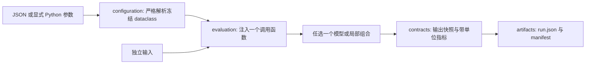

# UniverseModel 通用工程框架

Universal 的核心是**同一套工程接口允许选择不同任务、资源、组合范围与模型精度**。每个模块保留专业的数据类型和行为，只在配置、运行记录、单位与产物边界共享约定。用户可以只运行一个公式、一个组件或一段路径。

本轮先落实工程基础；CIM MatVec 的 71-cycle 验收方案保留为后续局部台架任务。现有硬件行为覆盖与验证证据统一见 [STATUS](docs/STATUS.md)。

## 1 系统设计的四种关系

| 关系 | 表示什么 | 维护位置 | 约束 |
| --- | --- | --- | --- |
| 软件依赖 | 谁可导入谁的接口 | [modules.json](docs/architecture/modules.json) | DAG；结构检查核对实际 Python import |
| 硬件归属/连接 | 谁拥有资源、数据经过哪里 | chipmodel/systemmodel/clustermodel 的 composition/topology | 归属无环、实例唯一；互连可以有环 |
| 参数推导 | 哪些设计量决定哪些结果 | 各模块冻结 Params 与纯 derive/estimate | 公式、单位、适用域明确；派生量不重复编辑 |
| 任务依赖 | 什么必须先完成/可见 | compiler 的计划与 runtime/simulator 协议 | 满足数据可见性与有限资源；调用耗时不等于目标 cycle |

目录只划分软件责任。例如 memory 与 packaging 在 chipmodel 下平级；实际 SRAM/HBM 属于哪个 Die/Package，由资源实例与组合关系决定。trainingArch/inferArch 是场景设计入口，复用资源模型。

## 2 可运行的最短工程路径



模型也可直接调用。需要保存证据时才使用这个短路径；compiler、runtime、simulator 按研究问题接入。runner 只执行注入的函数，没有硬件调度状态，也不按配置中的字符串加载 Python 代码。

| 实现位置 | 接口 | 输入 → 输出 |
| --- | --- | --- |
| [configuration](configuration/UNITS.md) | `resolve_dataclass` / `load_config` | producer 定义的冻结 dataclass 类型 + JSON + dotted overrides → 参数实例 |
| [contracts/results](contracts/results/UNITS.md) | `ExperimentSpec` / `Metric` / `RunRecord` | 模式、来源、假设 + 输出/指标 → 不可变记录 |
| [contracts/versions](contracts/versions/UNITS.md) | `canonical_json` / `content_hash` | dataclass/JSON → 规范化文本与 SHA-256 |
| [contracts/units](contracts/units/UNITS.md) | `validate_metric_unit` | 单位 token → 规范词汇检查；cycle 另绑定 clock domain |
| [evaluation](evaluation/UNITS.md) | `run_experiment` | spec + configuration + inputs + callable → succeeded/failed 记录 |
| [artifacts](artifacts/UNITS.md) | `write_run` / `read_run` | 记录 ↔ 校验过版本、内容与身份的本地产物 |

调用函数保持小接口：`execute(configuration, inputs) -> (payload, tuple[Metric, ...])`。payload 可以是模块自己的 dataclass 或 JSON 值；记录时才投影为 JSON。此接口不约束 ADC、DRAM、GEMM 必须使用同一种请求格式。

## 3 所有主模块怎样逐步接入

下面是接入设计，不把候选接口列为已实现能力。基础字段、公式与注释规则见根目录 [AGENTS.md](AGENTS.md)；静态参数与动态状态分开。

| 模块 | 独立输入 | 主要输出 | 状态归属 | 下一项最小接入工作 |
| --- | --- | --- | --- | --- |
| contracts | 有版本的交换对象 | 校验过的值对象/诊断 | 不拥有业务状态 | 随实际需求增加能力、数据引用、计划契约；当前先用实验记录 |
| configuration | producer 参数定义、JSON、显式覆盖 | 冻结有效参数 | 只拥有草稿与解释记录 | 先复用严格 dataclass 解析；模板/来源链/迁移按需求加入 |
| costmodel | 结构、动作量、PVT 条件、来源 profile | 条件延迟/能量/面积与覆盖说明 | 特征化数据，不复制硬件队列 | 定义一个条件查询函数，缺数据返回明确未知/越域 |
| chipmodel | Params、映射后的操作/数据、边界条件 | 功能输出、资源工作量、局部估算 | 本组件资源与数值状态 | 现有单元通过小 adapter 接入记录；局部组合另验证 |
| systemmodel | 芯片能力、主机/板卡资源、I/O 路径 | 节点能力、可用容量、路径约束 | 板卡/主机共享资源 | 先定义 Board/Node 描述与静态引用/容量检查 |
| clustermodel | 节点能力、链路、拓扑与参与组 | 集群图、路由/割集约束 | 跨节点网络资源 | 先描述资源图与 group；通信算法归 runtime |
| workloads | shape、语义轴、dtype、输入/种子 | Workload 描述、独立参考/工作量 | 任务数据与参考，不拥有硬件 | 小纯函数提供任务工作量/参考；大数据后续用引用 |
| compiler | workload + 公共硬件能力 + 成本查询 | 合法映射、ROI、buffer/partial/操作计划 | 编译 IR 与计划 | 先定义最小计划生产/校验边界；可直接注入预制计划 |
| runtime | 显式计划/直接请求、已发生通知 | 派发/等待/追加操作 | 软件队列、stream、策略 | 先冻结提交/完成协议，再实现一种派发策略 |
| simulator | 注入的组件/策略、初态、时间协议 | 目标时间、计数、终止诊断 | 全局时间与事件，组件拥有局部资源 | 先评审事件/释放/可见性契约；有争用需求再写引擎 |
| artifacts | 生产方对象、内容引用、状态 | 不可变产物与来源清单 | 存储一致性，不判断数值正确 | 当前小记录本地保存；大数组、轨迹、存储后端随后扩展 |
| evaluation | 实验问题、显式参数/输入、模型调用 | 运行记录、验证与比较 | 实验编排，不复制模型状态 | 当前单次运行；后续扫描先复用同一接口与失败口径 |
| ui | 同一参数定义、诊断、已保存结果 | 草稿修改、配置 diff、结果展示 | UI 草稿与视图 | 等基础参数接口稳定后做最小 CLI/表单；通过 evaluation 调用 |

训练与推理共享 workload/plan/resource/result 边界。训练额外描述前向、反向、更新、activation/梯度/optimizer 活跃量；推理额外描述 prefill/decode、KV 布局、上下文和到达过程。它们在上层提出需求，硬件模型接收显式工作量；不按场景名预判瓶颈。

## 4 配置与数值约定

- 参数由各模块的冻结 dataclass 定义，字段旁说明术语、单位、范围与公式；配置解析调用原有 `__post_init__`。JSON 支持嵌套 dataclass、有限数、严格 bool/int、Literal、optional、tuple；数组转不可变 tuple。
- 覆盖顺序是参数类默认值 → JSON 文件 → 显式调用覆盖。同一次调用的 dotted overrides 按给定顺序应用；数组整体替换。未知字段、派生字段覆盖、错误类型或不兼容 schema 直接失败。
- 纯公式继续用 Python 函数，计算字段保持只读。字符串公式、模板继承、YAML 与完整 provenance 解析未纳入本轮。
- 规范指标使用 second、byte、joule 等 token；ns/GB/s 是显示换算，不可省略比例因子。cycle 指标必须带 clock_domain；存储 bit、DMA byte、物理 cell action 和 MAC 独立计量。
- `value=None + unknown_reason` 表示未知；零值表示明确零。estimated、lower_bound、simulated 分开；只有 event 模式允许 simulated 指标，模式声明本身不证明事件模型正确。

## 5 运行、隔离与证据

`run_experiment` 在调用前保存有效参数/输入快照，将深拷贝交给调用函数。callback 或结果校验失败形成 failed 记录，不返回伪造输出。可序列化之前的输入错误直接报错。闭包、文件与外部服务的状态由调用者管理；状态模型应在每次调用中新建或显式传入初态。

`run_id` 区分一次尝试；`identity_hash=SHA256(canonical_json(spec, configuration, inputs))` 标识本次实验内容。run_id、宿主时间、输出不进入输入身份；源码引用、seed、初态与模型条件须显式进入 spec/configuration/inputs。规范化 v1 区分 1 和 1.0，拒绝重复 key、非有限数与非字符串 key。

记录保存 mode、assumptions、source_revision 与带单位的指标。`host_elapsed_s` 仅记录宿主执行与结果收集开销。succeeded 表示本次调用/记录有效，功能校验另由参考比较提供；保存文件也不代表可以恢复 simulator 状态。

本地 bundle 为 `run.json + manifest.json`。创建新目录，先写完整运行内容，再写清单作为提交标记；读取核对版本、字节数、SHA-256、状态与输入身份，并重做记录结构校验。已有目录拒绝覆盖；中断留下未完成目录，读取明确失败。本轮不承诺断电持久化或多文件事务。

这是小数据工程接口。大张量/轨迹后续由 DataRef/blob 扩展；当前 source_revision 默认为 `unrecorded`，不会宣称完整源码可复现。规范见[产物设计](artifacts/docs/design.md)。

## 6 直接使用

仓库根目录运行，Python 3.10+，业务代码只依赖标准库：

```text
python -m example.universal_demo --case adc
python -m example.universal_demo --case dma
python -m example.universal_demo --case adc --set configuration.adc.lane_count=8
python -m example.universal_demo --case dma --set inputs.payload_bytes=64 --output data/runs/dma-demo
```

可用 `--config` 替换 JSON、`--source-revision` 显式记录代码来源。样例配置在 [ADC](config/experiments/universal_adc.json) / [DMA](config/experiments/universal_dma.json)，对应 producer 字段在 [example](example/README.md)。已有 `example/specs` 结构 JSON 继续按其自身 schema 使用。

跨工作目录导入模型时可选择 `python -m pip install -e .`；[pyproject.toml](pyproject.toml) 配置 13 个模块的 namespace package 查找范围，构建产物只包含已有 Python 实现，例子/配置仍从仓库运行。Python 是目前显式参考与工程层；未来 C++ 热点通过同一契约适配，不先把所有单元重写。

检查命令：

```text
python tools/check_model_rules.py
python tools/check_structure.py
python -m unittest discover -s tests/chipmodel -p "test_*.py" -v
python -m unittest discover -s tests/integration -p "test_*.py" -v
```

## 7 后续工程顺序

1. 用当前接口逐步导出现有模块的可查询能力、字段、单位与覆盖边界；依据真实调用补充契约。
2. 定义最小 workload、硬件能力与 plan 的独立输入/输出，加入局部引用/容量/依赖检查；继续支持直接参数和预制计划。
3. 增加统一实验定义、有限参数扫描与已有产物分析，先验证身份、失败样本与比较口径。
4. 在具体争用问题出现后，冻结提交/完成/可见性协议，再实现 runtime/simulator 的最小闭环。
5. 选择 CIM MatVec 或 GEMM ROI 等局部台架检验通用边界，再扩展单层训练/推理账本、背压与物理校准。

每一步都交付可独立调用的函数与证据。候选模块保留设计入口；只有具备实际行为、公式与验收条件时才增加代码类。
