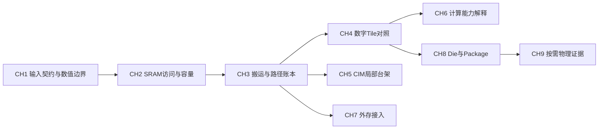

# chipmodel 开发任务与验收计划

日期：2026-11-23。顶层依据为[项目使命](../../PROJECT_MISSION.md)，开发约束见[本模块规则](../AGENTS.md)。CH1–CH4首包已执行：G1/G2修复、SRAM访问/容量绑定、搬运账本、数字Tile及Linear适配已实现；模型边界、对照与复现见[基础指南](foundation_usage.md)。CH5完整局部CIM数值/资源/保持台架也已实现并验证，见[CIM指南](cim_bench.md)。CH6的CPU/GPU/NPU能力与瓶颈解释已实现，见[能力指南](compute_capabilities.md)；CH7外存与缓存接入已实现，见[外存指南](memory_access.md)；CH8共享资源与跨Die组合已实现，见[组合指南](assembly.md)；CH9精确来源查询、资源/物理账本和热轨迹已实现，见[物理证据指南](physical_evidence.md)；CH10已完成跨包数值审计、统一验收和文档收尾，见[完成报告](completion.md)。下面的源码盘点和缺口复现保留为开发前基线。长期使命不在本页另行维护，实际完成状态统一见[STATUS](../../docs/STATUS.md)。

## 1 本阶段要支持的研究判断

围绕映射后的AI计算与数据访问，首先回答：**在相同任务、数值要求和硬件预算下，数据布局、局部驻留及资源共享怎样改变容量可行性、真实工作量与必要服务瓶颈？** 先形成可复用的存储/搬运/组合能力，再验证数字计算与CIM的不同约束。

每项开发都要同时交付：研究问题与对照条件；资源所有权、输入输出、参数关系和模型精度；独立参考、反例及可保存的证据。不能把模型运行成功直接写成研究结论。

任务语义、训练/推理流程、KV布局和映射策略继续由workloads/compiler/runtime负责；chipmodel接收显式工作量、地址、资源请求和边界条件。分析、功能计算、静态计划验证与事件执行分别标注，按研究主张选择实现深度。

## 2 开发前实现与缺口盘点（历史基线）

本次检查23份chipmodel Python源码；现有44项芯片测试通过，chipmodel_demo运行通过。示例为24 MAC、20 B输入、24 B输出、88 B槽预留，孤立阶段为4/8/4 cycles，局部依赖下界16 ns；示例明确没有接入SRAM/DRAM访问时序、背压和物理成本。通过这些测试不表示下表缺口已消失。

| 目录 / 当前源码 | 已有可运行能力 | 当前缺口及对应任务 |
| --- | --- | --- |
| [common.py](../common.py) | 数值校验、固定ClockDomain、P/L/II流水线 | 与组合模型的整数/浮点支持域和派生量诊断对齐，CH1 |
| [composition](../composition/UNITS.md) | ResourceNode/Port/Connection、归属/协议校验、摘要与后代互斥、DAG和资源包络下界 | 输入检查不完整；图、实际数据路径和资源工作量仍由调用者分别填入，CH1/CH3/CH4 |
| [compute/cpu](../compute/cpu/UNITS.md) | 单类μop的前端/执行/提交速率上界 | 无程序执行和混合端口行为；需要按具体工作量给出瓶颈解释，CH6 |
| [compute/gpu](../compute/gpu/UNITS.md) | block/warp/register/shared-memory驻留上限及分配粒度 | 驻留约束不等于吞吐；缺少完整资源限制的解释和特定架构适用条件，CH6 |
| [compute/npu](../compute/npu/UNITS.md) | GEMM逻辑工作/存储量、MAC理想服务；上层已有线性映射和功能参考 | 本地操作数访问、供数与共享端口尚未进入已有线性硬件路径，CH2/CH4/CH6 |
| [compute/cim](../compute/cim/UNITS.md) | 电导阵列、DAC、TIA变换、ADC、保持约束、位串行动作量和移位累加 | 局部数值链与动作量存在，但尚无共同资源/数据身份贯穿的完整台架；编程/误差成本未知，CH5 |
| [memory/sram](../memory/sram/UNITS.md)、[buffer/cache](../memory/UNITS.md) | SRAM组织/地址到bank/独立R和W峰值；槽容量；cache几何 | 缺显式访问拆分、逐bank服务需求、共用RW端口及槽到底层存储的绑定；cache行为仍未实现，CH2/CH7 |
| [memory/dram](../memory/dram/UNITS.md)、[controllers](../memory/controllers/UNITS.md) | 容量/接口带宽；单行隔离hit/closed/conflict读估算 | 组织、请求地址和读profile没有组合校验；不支持实际行状态推导、调度、写/刷新，CH7 |
| [memory/flash](../memory/flash/UNITS.md) | NAND几何、已给定页读/编程/块擦除的串行服务 | 无控制器、外部传输、FTL/GC和可靠性；HBF不得直接套用HBM行为，CH7 |
| [control](../control/UNITS.md) | 单DMA隔离burst服务、TensorLayout正stride/广播地址 | DMA结果不说明源读/链路/目标写的实际资源；布局span不是唯一数据量，CH3 |
| [interconnect/noc](../interconnect/noc/UNITS.md)、[d2d](../interconnect/d2d/UNITS.md) | 无争用NoC路径尾flit时间；D2D分包/编码/wire bits | 无片内共享路径账本；NoC返回时间但未导出完整传输计数；两类链路计量不能直接混加，CH3/CH8 |
| [composition/tile](../composition/tile/UNITS.md)、[die](../composition/die/UNITS.md)、[package](../composition/package/UNITS.md) | 通过父层ResourceNode表达容器，已有独立边界文档 | 无专用Python文件是合理复用；需要有行为的局部组合、共享与跨die验证，CH4/CH8 |
| [packaging](../packaging/UNITS.md) | 同层矩形包含/重叠校验、一阶恒功率热RC | 未绑定资源/功率来源；无多die热网、PDN、制造成本和校准，CH9 |
| [registry](../registry/UNITS.md)、[docs](UNITS.md) | 显式独立工厂表、全部目录UNITS和规则检查 | 沿用已有配置/记录，按实际接入补能力说明、版本和实验入口，CH10 |

候选硬件机制仍查[组件清单](component_inventory.md)；该清单不作为必须创建的类列表。开发前costmodel尚无Python成本provider；CH9已实现精确条件查询，实际范围见[物理证据指南](physical_evidence.md)，仍不能假定所有硬件成本已校准。

## 3 开发前确认的问题与修复状态

| 编号 | 复现输入与当前结果 | 开发处理及验收 |
| --- | --- | --- |
| G1 | ResourceDemand.amount=2^53+1 B，ResourceBudget.initial_credit=2^53 B、rate_per_s=1 B/s，操作latency=0；estimate_time_bounds返回resource_bound_s=0，精确包络式应为1 s | CH1明确计数与连续量支持域；保留已接受整数差值，或在边界显式拒绝不支持的精度。禁止接受后无提示地吞掉剩余工作量；增加有理数参考 |
| G2 | ActionEstimate的dependencies传入字符串`"load"`，构造后成为`("l","o","a","d")` | CH1拒绝字符串冒充ID序列，校验依赖/需求/端口等成员类型；直接调用与配置解析具有一致合法域 |
| G3：覆盖缺口 | 槽容量、SRAM峰值、DMA服务、NoC时间和ActionEstimate目前分别查询/填写；没有统一路径检查保证所有源读/链路/目标写已计量 | CH2–CH4建立显式资源绑定和逐边界账本；以同一任务的布局/共享反例检验，不预设通用动态引擎 |

G1是有限精度下的表达问题，不表示普通规模计算普遍失效；G2是输入契约问题。两者现已修复：Fraction中间量保留整数差值，直接调用/JSON均通过；字符串序列被拒绝。源码哈希、环境、探针输入输出和现有示例结果在 `.build/chipmodel-planning-20261123/audit.json`。

最小复现G1/G2（保留旧观察作为反例；当前版本第一行返回1.0，第二行抛TypeError）：

```python
from chipmodel.composition.bounds import (
    ActionEstimate, ResourceBudget, ResourceDemand, estimate_time_bounds,
)

action = ActionEstimate(action_id="move", latency_s=0, dependencies=(), demands=(
    ResourceDemand(resource_id="port", work_unit="B", amount=2**53 + 1),
))
budget = ResourceBudget(resource_id="port", work_unit="B", rate_per_s=1,
                        initial_credit=2**53)
print(estimate_time_bounds((action,), (budget,)).resource_bound_s)  # 修复后1.0；旧结果0.0。
print(ActionEstimate(action_id="compute", latency_s=0,
                     dependencies="load", demands=()).dependencies)  # 修复后抛TypeError；旧结果拆为4个字符。
```

## 4 按研究问题划分的开发任务

CH0盘点与CH1–CH9基础已完成，CH10实验/文档/来源要求随各包落实，并已完成[统一验收](completion.md)。CH5完成局部数值链、资源/精度对照与保持验证，CH6完成能力解释，CH7完成外存/缓存接入，CH8完成共享资源与跨Die组合；CH9已完成有来源的最小查询与几何/能量/热证据接口，实际器件校准和联合可行性按研究主张扩展。P0表示首包，P1表示复用首包的局部扩展，P2按课题证据条件进入。各包实际验证结果见STATUS。

| 任务 / 优先级 / 依赖 | 研究什么 | 怎样建模及交付位置 | 如何证明 |
| --- | --- | --- | --- |
| **CH1 基础契约与下界修复**；P0，无新增依赖 | 相同有效工作和资源声明能否得到稳定、可解释的必要时间？ | 修复G1/G2；复核common及composition/graph.py、bounds.py的输入序列、身份/单位、数值支持域、空工作、派生量溢出/下溢。专业值对象继续小而独立 | 有理数参考、输入乱序/重复/缺失/环、正工作不能因数值下溢伪装为零；保留旧合法示例和摘要互斥行为 |
| **CH2 SRAM访问与容量绑定**；P0，CH1 | 同样逻辑字节，地址布局、bank冲突与R/W共享如何改变服务瓶颈？ | memory/sram增加显式字节请求到word/bank事务的静态分析；声明独立R/W与共用RW端口语义；buffer槽引用唯一backing区域，区分payload、span、预留和物理容量 | 地址枚举独立参考；尾字/非对齐/越界/零请求；均匀与集中bank、1R1W与1RW反例；多个槽不能超额预留同一物理空间 |
| **CH3 搬运与路径账本**；P0，CH1/CH2 | 一次DMA经过哪里，哪些共享资源限制它，协议和访问粒度放大多少工作？ | control/data_movement、interconnect/noc/d2d及composition的显式适配；绑定源地址域、目标地址域、DMA、路径、源读/目标写；输出payload/word事务/flit/frame/wire bit和对应资源需求 | 源/目标逻辑量守恒、尾包/对齐、多请求共享方向；量纲转换、缺路径/缺owner拒绝；完整摘要与内部展开互斥，延迟只在明确依赖下组合 |
| **CH4 数字Tile对照台架**；P0，CH1–CH3 | 固定GEMM/MatVec与预算，布局或驻留策略的收益来自流量、端口还是计算资源？ | composition/tile局部装配；MAC、SRAM、buffer、DMA和可选路径独立调用后组合。evaluation适配已有Linear计划；本地操作数访问须由明确映射提供，不能从外部DMA流量推定 | 相同输入/输出、MAC与边界流量守恒；整数独立参考；容量失败保留；改变布局/共享而固定数据预算；扫描MAC/DMA/bank能力，显示瓶颈迁移 |
| **CH5 CIM完整局部台架（已完成）**；P1，CH1–CH3，可与CH4后续工作独立推进 | ADC共享、位切片、模拟/数字求差怎样影响转换数、精度和外围瓶颈？ | compute/cim各子目录与局部组合：数字码→DAC V→阵列A→显式TIA V→ADC code→位权累加；统一编码/数据身份、样本保持容量、资源工作量；时序profile需显式来源 | 小矩阵整数/有理/电压参考、差分符号、尾列、饱和与溢出；增加ADC而累加器不变的反例；逻辑MAC/cell-evaluation/conversion分开；未知编程成本保留 |
| **CH6 计算能力与瓶颈解释（已完成）**；P1，CH1，组合验证复用CH4/CH5 | 不同执行组织为何受前端、驻留、精度、供数或尾批限制？ | CPU保留选定μop能力边界并报告限制项；GPU报告各资源驻留限制与profile域；NPU明确所选操作/输入及累加格式、L/II和实际工作，不从名称推断tensor/systolic行为 | 独立阶段最小值、驻留边界和尾warp；相同occupancy不能推出相同性能；格式不支持拒绝；MAC加倍仍受供数限制的消融 |
| **CH7 外存与缓存接入**；P1，CH2/CH3 | 更大工作集或不同访问组织如何改变供数粒度与代价？ | 先补DRAM组织/地址/单行读profile绑定，越行拆分或明确拒绝；CK/WCK/MT/s关系显式。NAND区分页阵列服务、page buffer和外部传输。Cache行为按实际轨迹课题选择策略，几何不冒充命中模型 | rank增容量不倍增共享总线带宽；单行hit/closed/conflict和越行边界；读写profile不混用；NAND页/块粒度与data/OOB独立；命中率需轨迹参考 |
| **CH8 Tile/Die/Package组合**；P1，CH3/CH4 | 多tile/chiplet增加资源后，收益是否被共享存储或D2D限制？ | composition/tile、die、package以引用和实际行为组合；固定资源清单/时钟域/外部端口；摘要和展开按同一指标口径互斥；独立子图不依赖完整系统 | 两tile共享一份SRAM/控制器不倍增容量；双die实际跨界字节；换时钟先换算second；归属与模型选择反例；规模测试记录宿主开销 |
| **CH9 物理条件与成本证据**；P2，有来源profile和明确主张，结构绑定依CH8或独立子图 | 服务参数和预期能效在给定PVT、几何/热条件下是否有依据？ | packaging绑定唯一资源、位置与外部功率条件；costmodel按真实来源接入最小成本查询。动态J/action、静态W和观测时长分开；多die热/供电仅在结论需要时细化 | 同层几何/热RC独立参考；面积边界无重计；误差与校准/留出条件；缺项保持None及原因；通信或计算下界不能当成真实运行时长积分漏电 |
| **CH10 实验、兼容与文档**；贯穿每个任务 | 比较是否同输入/同预算，能否说明成功、失败与未知？ | 复用configuration、ExperimentSpec/RunRecord、artifacts及evaluation；registry保持显式工厂。各模型专业Params/Input/Output；更新UNITS、使用样例、STATUS及必要参数清单 | 可独立调用；严格配置、输入不可变、来源/假设/版本、失败记录和保存回读；相关业务回归、规则/结构检查；功能通过与分析/物理证据分列 |

CH9所需外部特征化不是CH1–CH5分析/功能基础的前置条件。CH6–CH8先完成表中实际比较需要的最小子集，其余机制按触发条件列入后续课题；不因目录名生成空模型。CH10与实现同步验收。

## 5 首个实现包：CH1 → CH2 → CH3 → CH4

先从 `composition/bounds.py`、`composition/graph.py` 与 `common.py` 开始修复CH1。接着实现SRAM事务与资源需求，再连接DMA/互连，最后用已有数字线性路径形成第一组同预算实验。该顺序复用已有功能参考，能先把共享资源计费规则验证清楚；CH5再复用这些规则深化CIM特有的编码与外围约束。



### 5.1 CH2独立手算夹具（已实现并验证）

显式假设4个bank、每bank 16个4 B word，共256 B；低位word interleaving。每条请求独立执行，不自动合并重复读；请求在起点就绪且无其他访问。以下数值已由独立测试验证，仅属于声明条件下的SRAM隔离服务。

| 情形 | 相同逻辑需求与改变项 | 预期计量/行为 |
| --- | --- | --- |
| 均匀与冲突 | 4条4 B读；地址分别为0/4/8/12，或0/16/32/48 | 两者payload均16 B、4次word读；逐bank工作为(1,1,1,1)与(4,0,0,0) |
| 明确的理想读服务 | 上述输入；每bank 1读端口，L=II=1 cycle，1 GHz | 无其他限制的局部服务为1与4 cycles；不能外推为整个GEMM或真实芯片时间 |
| 共用与独立端口 | bank 0不同word上的1读+1写，无数据依赖，L=II=1 | 1RW需2次串行服务；独立1R1W可各1次；两方案硬件预算不同，须标为端口消融 |
| 非对齐尾字 | 从地址3读2 B，按word访问，无额外cache/合并 | 逻辑2 B触及word 0和1，2次读，word服务量8 B；若profile不支持该访问则显式拒绝 |
| 槽预留 | 总SRAM 256 B，两个不重叠128 B槽；再加入重叠或越界槽 | 合法时仍只有256 B backing；别名须显式表达，不能无条件当作独立空间 |
| 读写边界 | 零请求；地址255长度2 B；无写能力资源上的写 | 零请求无工作；越界与不支持操作有明确诊断 |

相关输入从[参数清单](../../ARCHITECTURE_PARAMETERS.md)第5.1/5.2节选择：bank/word组织、地址域、端口类型、L/II、clock和容量；专业字段以实现代码及UNITS为准，L、共享RW和byte-enable能力均已加入SramParams，旧合法配置保留默认独立R/W行为。

### 5.2 CH3–CH4的计量与比较约束

每个局部请求至少能追溯逻辑数据身份、源/目标、真实路径、每个资源的服务单位和工作量。独立输入允许直接给出有限请求，不强制经过compiler；需要接已有Linear计划时，由evaluation/适配层连接两侧专业类型，chipmodel不导入compiler。

同一条传输采用完整服务摘要或展开的源读/通道/链路/目标写之一；若DMA参数只覆盖控制/通道，需声明剩余阶段并单独计费。流水线路径不能把每跳完整消息序列化机械相加。必要延迟只按明确的因果语义组成，资源界与依赖界分列；若不能建立对应条件就保持未覆盖。

CH4首先比较同一任务和硬件预算下的地址布局或现有output_stationary/reload_partials映射。保持输入、数值规则、资源数、时钟、容量、profile和比较范围一致；完整记录两种映射的额外工作，不以删减需求换取收益。增加bank/端口/ADC或容量的实验另标资源消融，不能混入同预算主比较。

首包只主张功能/容量/工作量与条件下界。双缓冲的容量条件可检查；实际重叠收益需额外定义有限槽、数据可见性和静态合法调度或事件执行，再报告可行完成时间。

## 6 既有提案与后续精度门槛

已有[CIM 71-cycle和数字92-cycle手算提案](../../docs/architecture/composable_simulation.md)保留为条件明确的候选验收夹具。它们涉及阶段时序、槽占用和交付边界，不能只把独立函数连调后声称已经实现。CH5可先完成纯功能/工作量/分析入口；选择实现该调度夹具时，另验样本保持、端口共享、填充/排空和最终可见事件。

| 触发研究主张 | 所需新增证据与归属 |
| --- | --- |
| 排队、实际计算/搬运重叠、尾延迟 | 在runtime/simulator边界明确接受/完成/可见/释放、有限容量和时钟规则；chipmodel提供必要局部行为 |
| 量化、稀疏、近似或CIM误差的AI收益 | workloads/reference负责数值及任务质量；硬件动作、额外转换/索引流量及成本同步比较 |
| CPU程序或GPU kernel执行时间 | 选定指令/执行后端及profile，补依赖、访存和调度证据；现有峰值/occupancy不足以作结论 |
| 缓存、DRAM控制器或PHY机制 | 选定访问轨迹、协议子集和固定版本参考后端；记录控制状态、时序合法性及适配损失 |
| EDA搜索或物理/能效改进 | 明确搜索空间、预算、候选合法性及profile来源；需要时引入综合/FPGA/实测，保留校准和误差 |

这些扩展按实际结论需要进入，不作为所有局部模型的统一前置条件。

2026-11-24新增[RTL接入文档](../../rtl/README.md)。当前范围仅设计、接口、模型映射、验证要求与Unit规格模板，不启动MAC/FIFO等候选实现、不新增HDL/工具流程。后续具体研究需要RTL证据时，再按该规格选择局部Unit；CH1–CH10基础完成状态不因此变成RTL已实现。

## 7 每项任务的完成条件

| 检查项 | 交付要求 |
| --- | --- |
| 问题与比较 | 说明机制、基线、固定预算、改变因素和可观察量；单元基础设施说明所服务的研究需要 |
| 参数与边界 | 查ARCHITECTURE_PARAMETERS后选实际子集；输入/派生/状态/观测分离；来源和未知成本明确 |
| 独立与组合 | 短路径直接调用；唯一owner和资源身份；路径/协议/计量兼容；摘要与细模型不重复计费 |
| 独立证据 | 手算/有理/枚举参考、边界反例、守恒；按问题增加敏感性、消融和瓶颈证据 |
| 工程与来源 | 保存有效参数、输入身份、源码/模型版本、假设、成功与失败；回读不执行模型 |
| 文档与检查 | 定义/字段注释、实现目录及祖先UNITS、必要参数关系和STATUS同步；相关业务测试及两个规则检查通过 |
| 声明范围 | 区分functional、analytical、static_schedule和event；性能下界不冒充完成时间，host时间不进入目标指标 |

本阶段进展按任务验收更新，不按类数或目录填充率统计。从44项芯片测试基线扩展到契约/地址/路径/共享的独立回归，并接入数字Tile同预算实验及资源敏感性。CH5–CH8已依次补充CIM数值/资源、计算能力、外存/缓存和多Tile/跨Die证据；CH9已接续固定来源点、条件成本与物理账本，后续只扩展与具体研究主张有关的校准和执行证据。
