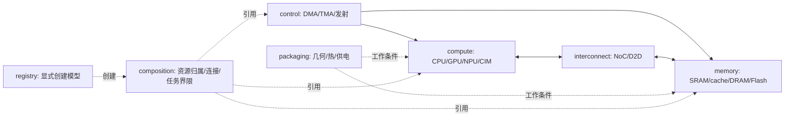

# chipmodel 的系统级参数与分析设计

本轮交付深度是各子模块的参数、派生公式和可独立调用的基础模型。系统目标是把一条研究路径的工作量、资源、通信、容量与时间联系起来，支持只启用其中一段。CPU/GPU 的完整 ISA 执行、DDR 命令调度和全局事件仿真属于后续覆盖。

## 第一性：先守住什么

继承[项目第一性原理](../../docs/architecture/first_principles.md)。芯片是执行状态变化的有限物理系统：操作语义规定应该发生什么，数据位置与映射规定经过哪里，资源和依赖约束何时发生，电路与工作条件决定代价。由此得到最小对象集合：工作负载、状态、操作、资源、连接、物理条件。

1. 功能必须正确或满足明确误差界。位宽、符号和量化范围先于性能比较。
2. 数据与资源计量必须守恒。存储占用由活跃对象决定，跨边界字节由实际传输决定，复制、编码、padding 和重算要显式计入。
3. 每种资源在任意时间窗口内只有有限供给。初始 burst credit 与持续速率分开；有限队列与保持时间约束留给相应状态模型。
4. 后继只能在协议规定的输入可见后执行。静态依赖下界、资源下界和真实调度时间是不同结果。
5. 面积、能量和误差必须有物理或特征化依据。没有来源的量保持未覆盖，不靠默认零补齐。

极简的尺度是“能否解释当前决策”：只保留会改变可行性、瓶颈、方案排序或质量的机制。完善单位、假设和验证，比增加抽象层更重要。

## AI 训练与推理如何提出需求

| 场景 | 优先观察的系统目标 | 传入硬件模型的需求 |
| --- | --- | --- |
| 训练 | step time、有效吞吐、收敛/数值质量、容量和能量 | 前向/反向/更新工作，activation/梯度/optimizer 活跃量，通信/重算/重叠路径 |
| 推理 prefill | TTFT、prompt 吞吐、峰值容量 | 输入长度/batch 产生的矩阵工作、activation 与 KV 写入、权重供数 |
| 推理 decode | TPOT、并发下的吞吐与尾延迟 | 随上下文增长的 KV 读取/追加、权重流量、小矩阵利用、批处理与共享资源 |

这些场景并不分别对应一套硬件类。Attention/GEMM 的工作语义、KV 布局和 TP/PP/DP 等策略归上层；chipmodel 接收映射后的工作量、地址和数据路径。计算密集或带宽受限是由实际算术强度、重用和能力共同决定的结论，不按 prefill/decode 名称写死。

## 四种关系与七个子系统

| 关系 | 表达 | 约束 |
| --- | --- | --- |
| 资源归属 | package → die → tile/core → leaf resource | 身份唯一，包含无环；容器不凭空增加延迟/容量 |
| 物理/协议连接 | compute ↔ memory ↔ interconnect；control 驱动操作 | 连接可有环；方向、协议和量纲兼容，适配必须显式 |
| 参数推导 | 组织/时钟/编码/特征值 → 容量、速率、服务需求 | 派生依赖无环；每个结果保留单位与作用域 |
| 任务依赖 | 装载 → 转换/计算 → 写回，部分阶段可重叠 | 操作 DAG 不等于物理拓扑；分析下界不冒充真实调度 |



registry 是软件创建入口；docs 是规范与参数说明。两者不模拟片上硬件。共享数学校验和固定时钟/流水线公式留在 chipmodel 内部公共工具；它们不推进全局时间，不反向依赖 simulator 或 compiler。

## 本轮接口层次

参数类是冻结设计输入，模型构造校验并生成只读属性；查询接收显式工作量，返回声明单位的分析结果。功能模型显式接收数据并返回数值。每个基础模型可直接构造；registry 仅提供可选的名称到构造器映射。

计算用明确操作计数；存储分别计 payload、访问粒度和物理容量；互连分别计 payload、协议字节和编码后的 wire bits。统一时间汇总采用 second，本地 cycle 留在所属 ClockDomain。每条公式声明“所有输入已就绪、资源空闲”等前提。

复用流水线公式 `G=ceil(W/P)`、`C=L+(G-1)II` 仅适用于 P 个等价并行槽的无争用工作；它不能代替 GPU occupancy、DRAM 行访问或 NoC 路由的专用约束。组合层从操作依赖得到 critical-path 下界，从资源工作量得到另一项下界；不能把所有子模块的峰值相加当作系统性能。

资源供给使用显式包络 `W(T)≤b+rT`，因此必要时间为 `max(0,(W−b)/r)`；b 表示首批/突发供给上界。此处避免将带启动/恢复特性的短批次机械地代入 W/r。完整公式和字段见 [composition](../composition/UNITS.md)。

## 模型覆盖与资源计量

CPU 前端/执行、GPU occupancy、NPU MAC、CIM 外围采用不同参数模型。SRAM、cache、DRAM、Flash 分开表达组织；DDR 的容量、有效数据率与行访问时序分开。DMA 描述搬运服务，TMA 描述地址/布局，数据实际经过的存储和链路需要显式组合。

两种计量路径择一：用一个完整校准的 macro 摘要，或展开其内部叶子资源。组合树中的有成本模型节点不能同时选中其后代成本模型。容器节点只拥有引用，model_id 为空。同一叶子资源可被多个操作依次使用，这不是重复计费。

## CIM 局部路径怎样接起来

```text
输入字节/张量布局 → DMA/缓冲容量 → 数字码
  → DAC 电压 [V] → conductance array [S] 求列电流 [A]
  → 显式跨阻 [Ω] / 偏置 [V] → ADC 输入 [V] → code
  → 位权/符号处理与累加 → 输出字节 → DMA/存储
```

每一段都可替换成直接激励或边界条件。阵列权重编程、采样保持的生命周期、共享 ADC 与有限接收端会改变时序，不能由上述纯功能链的 Python 调用时间代表。原有带符号等效列和夹具与本电压/电导路径具有不同编码，需显式适配后比较。

## 首轮验收

检查字段/注释/模块文档完整性；用独立手算验证容量、DDR 带宽、尾批/突发、GPU 资源约束、CIM 数值、热 RC 和组合下界。示例同时展示独立查询与跨模块装配。所有结果明确是 functional 或 analytical；未实施的刷新、背压、缓存命中、ISA、误差和校准不计作已覆盖。

代码与参数总入口是 [chipmodel/UNITS.md](../UNITS.md)。运行 [chipmodel_demo.py](../../example/chipmodel_demo.py) 可查看配置、操作依赖、资源供给与输出下界；模块内部的参数表从源码注释生成，保持单一维护定义。
