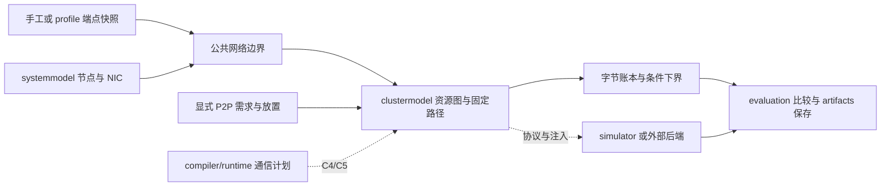

# clustermodel：集群、交换网络与资源组

设计及C1–C3基础实现日期：2026-11-23。本文落实[项目使命](../../PROJECT_MISSION.md)，细化模块边界。链路/交换、固定路由、rank/group、通信账本与条件下界已按[基础指南](foundation_usage.md)实现；C4/C5执行及AI/物理证据为研究扩展。状态见 [STATUS](../../docs/STATUS.md)，次序见[开发计划](development_plan.md)，字段见 [UNITS](../UNITS.md)。

本轮按[覆盖矩阵](coverage.md)完成基础范围：固定P2P、多层leaf-spine、最短路径计数/候选、静态停用和集群需求总览，见[横向指南](breadth_usage.md)。调用内索引与复用优化保持原有输入/输出schema和计量语义，见[完成报告](completion.md)；下一轮进入chipmodel。

## 1 研究问题与首批范围

本模块回答：给定节点能力、网络连接和显式通信需求，哪些放置与路径可行，瓶颈在哪里，改变链路、端点注入或共享交换能力会带来什么影响？节点数和设备峰值之和不足以回答这些问题。

| 研究需求 | 本模块的行为与证据 | 相邻模块补充的证据 |
| --- | --- | --- |
| 分布式训练扩展 | rank/group 放置、路径字节、注入/交换/链路约束；比较同一计划的不同放置 | collective 展开、规约与梯度参考、计算 profile、step time 与质量 |
| 推理激活/KV 传输 | 显式源/目标/版本/长度，路径与共享瓶颈；后续交付时间 | 数据可达与目标可见、到达/batch/KV 管理、TTFT/TPOT/goodput |
| 异构系统协同设计 | 不同端点能力、拓扑和资源预算的可行性及敏感性 | 节点计算/内存、带来源成本与物理约束 |
| EDA/设计空间探索 | 独立纯查询、稳定身份、不可行诊断与资源账本 | 候选搜索、搜索预算、Pareto 比较与留出验证 |

**首批 C1–C3：静态资源图 + 固定路径 + 通信负载账本 + 分析下界。** 固定四个节点、两台交换机及同一组 P2P 消息，比较两种 rank 放置对共享上行的影响。这是通信基础设施验证实验，不能据此宣称训练加速或论文创新。

支持手工图、直连/单交换机/小型两层网络、异构正带宽、全双工方向、显式共享约束、重叠通信组和单节点退化情况。交换机不默认具有硬件规约；自适应路由、包级拥塞/重传、故障恢复和多作业调度按具体课题加入。静态停用视图已可移除指定方向/owner关联链路，但不模拟故障时序或恢复。

## 2 系统边界与资源所有权

| 对象或行为 | 唯一所有者 | 集群层如何使用 |
| --- | --- | --- |
| CPU/GPU/NPU/CIM、芯片内存和片内网络 | chipmodel 实例 | 经节点边界引用能力，不复制设备状态 |
| 主机、节点内互连、DMA、NIC 与 NIC 队列 | systemmodel | 引用节点/端口及共享注入/接收约束，不创建第二份 NIC |
| 跨节点链路、交换内部资源与局部网络状态 | clustermodel.fabric | 定义容量和计量边界；C4 才引入执行状态 |
| 连接图、节点集合、rank/group 引用 | clustermodel.topology/composition | 维护图与引用；组不生成设备或独占带宽 |
| 张量划分、放置优化、静态通信计划 | compiler | 校验给定放置与需求，不在硬件模型里搜索并行策略 |
| collective 算法、软件队列、分块、同步和重试策略 | runtime | 接收展开的 P2P 工作，不从 DP/TP/PP/EP/CP 名称猜字节量 |
| 全局目标时间和事件队列 | simulator 或选定外部后端 | 通过公共协议交换服务与通知，不嵌入第二套全局引擎 |
| 装配、配置、比较、记录与成本查询 | evaluation/configuration/artifacts/costmodel | 显式注入；底层不反向导入编排模块 |

分别保存物理归属树、允许有环的连接图、参数推导 DAG、任务依赖 DAG。rack/pod 是放置或故障域标签；出现独立行为后再建模型。每个物理实例只有一个 owner，多个组可引用同一端点或带宽约束。

同机通信由 systemmodel 提供路径。当前未接入节点路径摘要，所有同节点正消息诊断 `unsupported_local_path`，不能把本地流量设为免费。空通信集可返回明确零流量/零通信下界，不代表节点计算时间为零。

## 3 不依赖完整节点和运行时的开发路径

systemmodel/runtime/simulator 尚无可运行模型。C1–C3 接受手工假设或有来源 profile 提供的只读端点快照，不等待完整 Node。它只覆盖声明的 NIC 边界，设备内存到 NIC 和远端内存可见性没有自动获得覆盖。

最低公共边界已实现在 [contracts/hardware/network.py](../../contracts/hardware/network.py)：NetworkEndpointSpec 和 BandwidthConstraint 只依赖标准库，表示node/port/resource身份、方向、计量基准、容量和来源条件。值对象负责结构校验，字段和公共测试由[hardware UNITS](../../contracts/hardware/UNITS.md)导航。

实际 import 保持 [modules.json](../../docs/architecture/modules.json)：clustermodel 只可依赖 contracts、systemmodel、costmodel。runtime/simulator 通过公共协议接收 evaluation 注入的组件。C1–C3 的专业分析输入留在集群模块，C4 按实际跨模块使用提取请求/事件契约。

图表示数据与装配关系，不代表 Python import。端点摘要替换为细化 Node 时，同范围成本必须替换，不能同时累计摘要 NIC 时间和内部 NIC 时间。

## 4 逐目录职责与依赖

| 目录 | 首批已实现文件与行为 | 独立输入 → 输出 | 验证要点 |
| --- | --- | --- | --- |
| fabric/links | `model.py`：序列化工作与孤立服务 | LinkParams + 长度 → LinkEstimate | 单位、尾包、方向、效率不重复扣除 |
| topology | `graph.py`：引用/连接/指定割；`builders.py`：少量纯构图函数 | 端点、交换端口、边 → 图/可达性/割容量 | 允许环；拒绝悬空边、重复身份、非法端口占用 |
| fabric/switches | `model.py`：端口及共享内部容量 | SwitchParams + 经过量 → 约束需求 | 全双工口径、内部超售与资源共享 |
| fabric/routing | `paths.py`：显式路径、确定性最少跳 | 图 + 源/目标或边序列 → Route | 路径连续、方向正确、端点不充当中转 |
| composition/groups | `model.py`：rank 放置和组成员 | RankPlacement + CommunicationGroup → 校验引用 | 组内不重复；组间可重叠；多 rank 共享 NIC |
| composition/cluster | `model.py` 装配；`analysis.py` 账本/下界 | ClusterSpec + TrafficInput → TrafficAnalysis | 唯一资源；约束需求不冒充额外传输 |

内部依赖从底层向上：links/公共端点 → topology；switches 提供交换端口与约束，由 topology 接纳；routing 只读图；groups 校验逻辑放置；cluster 装配。links/switches 不导入 cluster，topology 不调用 routing，group 不管理网络队列。

NetworkGraph构造时调用validate_graph；get_link、reachable_endpoints、cut_capacity均可独立使用。direct-network-graph/v1保持C1直连范围；routed-network-graph/v1增加显式交换实例和内部连接。可达性遍历内部连接并在NIC停止，指定割接收完整node_ids和switch_ids。C3已聚合实际路径的共享需求，C4执行状态仍未接入。

## 5 参数、输入、状态和结果

字段按[参数清单](../../ARCHITECTURE_PARAMETERS.md)第 6、8 节筛选，精确定义由代码和各目录 UNITS 生成表维护。

| 类别 | 最小内容 | 约束 |
| --- | --- | --- |
| 设计/特征化 | 身份、方向、速率基准、延迟/开销、共享容量、来源与覆盖 | 冻结 dataclass；有限数；计数拒绝 bool/非整数；容量正、延迟非负 |
| 每次输入 | 消息 ID、src/dst rank、payload B、data/version、可选 group、路径或路由策略 | 显式来源；硬件参数不承载 batch/模型名；首批消息起点同时就绪 |
| 派生量 | 路径、wire/service bytes、约束需求、指定割容量/负载、下界 | 只读；不允许 JSON 覆盖或字符串公式 |
| 动态状态（C4） | 已接受请求、剩余服务、有限槽位、局部仲裁、epoch | 每次运行独立创建；全局事件归引擎，NIC 状态归 Node |
| 结果 | 每消息/方向/资源账本、瓶颈约束、下界、诊断和覆盖 | C1–C3 不生成排队时间、实际交付时间或实际利用率 |

独立函数为 `estimate_link(params, payload_bytes)`、`validate_graph(graph)`、`resolve_route(graph, src_endpoint_id, dst_endpoint_id, ...)`、`validate_groups(graph, placements, groups)`、`analyze_traffic(cluster, traffic)`。纯查询不更新硬件状态，不要求runner或完整执行链。

记录沿用 `execute(configuration, inputs) -> (payload, tuple[Metric, ...])`。已有 `ExperimentSpec.mode="analytical"` 和 `Metric.kind="counter"/"lower_bound"/"estimated"` 足够；资源、方向、范围与 profile 条件放专业 payload，Metric 使用唯一名称及规范单位。`simulated` 只用于已接入并验证的 event 运行。

## 6 计量与数学边界

分别记录逻辑 payload、每方向链路字节、资源服务字节。消息经过三条链路时源注入 payload 只计一次，每条链路分别计量；全网链路字节和不应被要求等于逻辑 payload。NIC、链路、交换资源可同时约束同一消息，它们的约束账本不代表三次额外逻辑传输。

容量基准二选一：原始线路 profile 使用 wire 服务量及尚未扣除的编码/协议开销；有效 payload profile 使用所声明条件下的 payload B/s。带包头字节不能再除以已经扣过同一包头开销的 payload 带宽。公式见 [links](../fabric/links/UNITS.md)。

对资源 r：服务率 `C_r [B/s]`，消息 i 的服务需求 `q_ir [B]`，`Q_r = Σ_i q_ir`。多个端口共享 NIC、交换内部容量、半双工共享方向均通过同一约束 ID 表达。全双工两方向默认独立；显式共享约束才限制合计吞吐。

对起点同时就绪、固定路径、无复制/压缩/重传的首批输入，`T_resource_lb = max_r(Q_r/C_r)`。另报告每消息传播与交换首数据处理延迟之和的下界；startup只属于孤立profile，不推断逐跳串行关系。延迟界、资源界与指定割界取max，不直接相加。

这里的下界以声明的模型服务容量为条件。实测平均有效吞吐不能自动作为真实硬件容量上界；使用拟合服务率时说明适用条件，只有容量上界有独立依据时才进一步主张相应硬件下界。部分已知链路字节可分项列出，含未知项的全网总量保持未知。

指定有向割 S 的 `B_cut = Σ_(e 从 S 指向外部) B_e`、`D_cut = Σ_e Q_e` 必须采用同一字节基准，给出 `T_cut_lb = D_cut/B_cut`。首批按固定路径的实际过割次数计量，同一消息多次过割需逐次累计；它不是任意通信算法的必需通信量下界。只检查调用者给出的割，不宣称求得全局二分带宽或多商品流最优解。

共享约束可能使链路容量和偏乐观，但仍提供松下界；端点/交换约束应同时保留。正需求遇零可用容量或不可达路径报告不可行，不输出 Inf/NaN；无需求的空割可返回零下界并说明口径。不同字节基准无法转换时拒绝合并割分析。

分析界用于定位必要服务瓶颈，不能当作可达到的完成时间。依赖 DAG、不同就绪时刻、逐跳流水、排队、窗口和公平性在 C4 按执行语义处理；无争用多跳也不能机械累计每跳完整消息序列化。依据见 M04/M06/M13/M15 [数学方法](../../docs/methods/parameters_and_math.md)。

能量按唯一 owner 和来源覆盖计量；缺运行时长不能把背景 W 换算成完整运行 J。首批集群总能量为 `None + unknown_reason`，已知部分另报。公共时间用 second，不假设集群统一时钟；cycle 先按域换算，tick 精度和舍入由执行协议声明。`host_elapsed_s` 仅衡量模型开销。

## 7 争用执行与外部工具（C4）

结论依赖排队、流速共享或交付顺序时进入 C4。先对照已有[工具比较](../../docs/reference/open_source_comparison.md)中的 ASTRA-sim、SimAI、ns-3，核对接口、粒度、profile 和构建条件；它们不处于完全相同抽象层。冻结一个版本和网络后端，以双流共享链路为最小案例，不要求全部安装，也不预先宣布选型成功。

外部进程由 evaluation 装配，协议转换放 simulator/adapters，以纯配置/计划数据为边界；clustermodel 导出自身公共表示，不导入重型框架。保存转换损失、后端/依赖版本及原始输入输出。外部结果替换同范围本地执行成本；本地分析界只作核对，不能再叠加到仿真时间。

若后端无法表达研究机制，再实现最小流级模型：固定路由、共享容量、有限接纳槽位、明确流速分配策略，活动流变化时重算服务。局部服务状态归组件，引擎只推进事件。需要逐跳 buffer/credit、包级丢包证据后再细化；流级结果不能声称覆盖这些机制。

至少区分 accepted、source_consumed、delivered、destination_visible 和 operation_completed。fabric 的 delivered 指远端 NIC 接收边界，目标内存可见由 systemmodel 确认，collective 完成由 runtime 确认。背压重试保持身份；取消、旧 epoch、同时间释放/发射和排空按[生命周期规范](../../docs/interfaces/resource_lifecycle.md)验收，不支持的行为明确拒绝。

## 8 AI 场景接入（C5）

训练先接一个 collective 计划及局部规约。ring/tree/分层算法放 runtime/communication；整数小向量用独立参考，浮点规定累加顺序和容差。规约由节点计算资源承担，不能免费计入网络。理想 ring 的每 rank `2(p−1)D/p` 只在均匀分片等条件下用于字节校验；尾片按实际计划计量，p=1 不生成网络传输。

推理先接一条来源明确的激活或 KV 传输路径；内容版本、布局和精度影响正确性。完整阶段和到达过程接入后才报告 TTFT/TPOT；网络实验只报告边界通信指标。

固定 trace 只支持给定需求的响应比较；策略改变消息长度、顺序或就绪时刻时，必须重新生成计划或闭环驱动。训练 step time 需要计算和同步；量化、压缩或丢弃还需要任务质量。异构资源不能直接按设备个数归一扩展效率。

## 9 验证与产物

C1–C3 验证结构不变量、独立手算字节/下界、同输入/预算放置对照与产物回读；C4 加因果、守恒、排空与外部对照；C5 加数值、AI 质量和完整工作量。模型吻合不等于物理校准；拟合与留出数据分开，误差门槛依据所需区分的效果量制定。

首批诊断区分非法配置、重复/悬空引用、不可达/非法路径、不支持的计量或功能、缺少/越域 profile。C4 再增加背压、死锁、超时及未排空。失败样本保留；RunRecord succeeded 只说明调用完成，不证明研究命题成立。

保存拓扑和唯一资源、端点来源/边界、消息及版本、rank/group、路由策略和最终路径、有效参数/输入/源码身份、假设、逐资源账本与结果；后续增加初态、随机种子、时间精度和外部版本。源码或 profile 条件不完整时注明缺口。每批实现同步 UNITS、STATUS 与必要测试，并运行两项仓库检查；具体案例见[开发计划](development_plan.md)。
