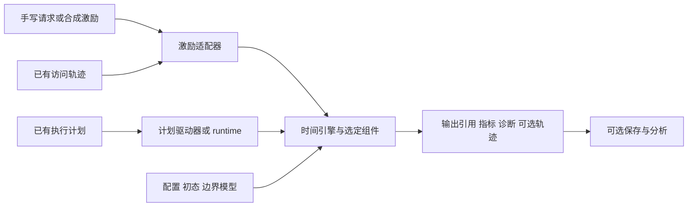

# 可组合组件与局部仿真规划

本文规划怎样只使用需要的软件模块和硬件组件完成一次研究。核心要求是：单组件、局部数据路径和完整系统使用同一套语义，调用方可以控制输入、初态、边界条件、模型精度与输出。完整实验链是一种装配方式。

本文及关联接口是设计提案，尚无可执行 API。现状见 [STATUS](../STATUS.md)；公共字段冻结前需完成第 10 节的契约修订。本文不要求把所有候选组件一次实现。

配套文档：[组件接口](../interfaces/component_protocols.md)、[硬件组件目录](../reference/hardware_component_catalog.md)、[指令与仿真精度](instruction_and_fidelity.md)。

## 1 软件模块与硬件实例分开

保留现有 13 个软件模块。它们划分代码职责；SRAM、ADC、DMA、矩阵引擎等是可实例化的硬件组件；双缓冲、缓存层级和数据流是组合或策略；ISA 规定可观察行为。不要为每个硬件名词新增顶层软件模块。

同一个 SRAM 类型可以实例化为两个不同容量的局部缓冲，也可以被多个计算组件共享。共享实例只有一个状态所有者。两个端口指向同一 SRAM，不等于拥有两份容量或两倍带宽。

独立使用分三个层次：

| 使用层次 | 例子 | 成立条件 |
| --- | --- | --- |
| 独立函数或阶段 | 查询 SRAM 动作成本、单独运行 tiling | 提供该阶段所需的明确输入与前置条件 |
| 独立组件 | 给 DMA 一组描述符；给 ADC 一组采样 | 补齐时钟、数据来源、接收端及反馈 |
| 局部子图 | SRAM → 数字引擎；DAC → CIM → ADC | 选中组件之间真实连通，切口处有边界模型 |

能够独立调用不表示每个模块必须完全无依赖。contracts 仍是共享语义基础；事件仿真仍需时间引擎；数值验证仍需独立参考。

## 2 按研究问题选择最短路径

| 研究任务 | 必要输入 | 最小调用组合 | 主要输出 |
| --- | --- | --- | --- |
| 只查一次动作的成本 | 动作、结构、工作条件 | contracts + costmodel | 带单位、适用域和来源的 Estimate |
| 只检查配置或拓扑 | 局部配置、参数定义、外部端口声明 | contracts + configuration；需要时加入组件校验器 | 有效配置、约束诊断 |
| 只做数值计算 | 小规模数据、操作与数值规则 | contracts + 组件功能入口；workloads 提供参考 | 输出、误差和覆盖范围，不声明硬件耗时 |
| 只运行一个编译 pass | 该 pass 的 IR、能力及必要分析 | compiler 的选定阶段 | 新 IR、失效分析与诊断 |
| 研究 SRAM bank 或 DMA 争用 | 请求序列、初态、局部组件 | contracts + chipmodel + simulator + 激励适配器 | 延迟、占用、访问量与阻塞原因 |
| 研究已有映射的硬件表现 | 合法计划、配置、输入引用 | 所选硬件 + simulator；按调度需要加入 runtime | 时间线、数据效果、局部性能 |
| 研究调度策略 | 抽象设备服务模型、到达过程 | runtime + simulator + 注入的设备模型 | 吞吐、排队、软件开销与公平性 |
| 研究缓存和 DRAM | 地址轨迹、初始缓存状态、控制器和介质 | 所选 memory 组件 + simulator | 命中率、请求合并、行冲突、内存时间 |
| 研究节点或链路 | 端点流量、消息/包、NIC/交换模型 | systemmodel/clustermodel + simulator | 注入瓶颈、链路争用、消息完成 |
| 分析已有结果 | 版本化结果及统计边界 | evaluation/analysis；需要读写文件时加入 artifacts | 新分析，不重新仿真 |

configuration 可以接收单组件配置；也可复用已经冻结并校验过的配置。artifacts 负责可持久化记录，但简单调用可先返回内存中的结果。未保存输入、版本与初态的运行不能宣称可离线复现。

省略 runtime 时，激励适配器负责约定的输入顺序、依赖与背压响应。它不代表真实软件没有开销：结果应声明软件调度和 launch 成本未覆盖。研究这些成本时再加入 runtime 或显式 CPU 工作。

evaluation/experiments 可提供便利装配函数，用户脚本也可以直接注入符合协议的对象。simulator 不反向导入 evaluation、chipmodel 或 runtime。激励适配器放 simulator/adapters，目标软件策略仍放 runtime。

## 3 局部仿真的切口必须有定义

选择一段路径时，先列出输入、输出、状态和反馈四类切口，再决定用实际模型、固定条件还是记录轨迹闭合它们。

| 切口 | 可选择的边界条件 | 必须记录的影响 |
| --- | --- | --- |
| 输入请求 | 固定时间轨迹、闭环源、随机源、上游真实组件 | 到达过程、随机子流、最大在途数、背压行为 |
| 输入数据 | 文件、生成器、已加载目标存储、仅元数据 | 数据版本；装载是否计入；数据依赖行为是否可预测 |
| 输出接收 | 有限速率/容量接收端、真实存储、理想接收端 | 接收端是否限制吞吐，何时交付和可见 |
| 缓存与地址 | 冷启动、合法快照、指定一致性响应器 | 标签/脏位/目录/页表及在途请求是否齐全 |
| 权重与器件 | 已编程权重、显式编程、给定漂移状态 | 是否包含编程/校准，器件差异与年龄 |
| 时钟和物理条件 | 固定 V/f/T、外部序列、反馈模型 | 是否覆盖变频、温度和供电变化 |

不能简单裁剪包含树并假定剩余结构可运行。例如缓存 miss 需要下级响应，DMA 需要源与目的端，credit 协议需要 credit 返回，带一致性的设备需要对应 snoop/目录响应；缺失时应在运行前报错。

理想源、理想接收端和无限带宽可以用于上界研究，但必须由用户显式选择并写入结果。不能把未连接端口自动当成零延迟成功。终止必须区分停止注入、排空在途请求和强制截断，避免把未完成长请求从统计中遗漏。

固定地址轨迹可比较“在此访问序列下”的缓存行为。若硬件反馈会改变未来访存、分支、压缩率或调度，固定轨迹不再足以预测完整程序，需要闭环驱动或功能执行。

## 4 每个软件模块的可控输入与输出

下表定义调用责任，不要求建立进程或网络服务。进程内函数、Python 对象与文件适配器共享同一语义；文件格式不能成为业务计算的强制中转站。

| 模块 | 调用方提供 | 返回或发布 | 独立使用的关键约束 |
| --- | --- | --- | --- |
| contracts | 值对象、协议版本、单位 | 规范对象、兼容转换、诊断 | 不装配硬件、不运行实验 |
| configuration | 任意合法作用域的草稿与定义 | 冻结配置、派生值、来源 | 不要求补一份空 Cluster/Node 配置 |
| costmodel | 动作、几何与 V/f/T 等条件 | Estimate 或 unavailable | 不拥有队列，不偷偷加入排队时间 |
| chipmodel | 单组件或子图规格、初态、服务、请求 | 能力、数据效果、事件、计数器 | 不要求存在完整 Die/Package 根实例 |
| systemmodel | 局部节点路径、端点、事务 | 可达性、传输与共享资源结果 | 未包含的主机/设备必须有明确边界 |
| clustermodel | 局部 fabric、端点注入与路由 | 消息完成、拥塞及链路统计 | 不要求真实运行完整设备内部 |
| workloads | 数据、shape、分布、数值规则 | 输入、WorkloadSpec、参考与校验 | 不强制经过 compiler |
| compiler | 选定 pass 输入、能力与策略 | IR、计划、分析及失效列表 | 跳过 pass 时必须已有其必要产物 |
| runtime | 计划/任务、到达、观测与反馈 | 请求、决策、软件统计 | 不读私有硬件状态，不使用未来信息 |
| simulator | 组件、驱动器、初态、时间与停止条件 | SimulationResult、输出、诊断 | 不强制要求 compiler 生成的计划 |
| artifacts | 产物对象、存储目标、来源 | 引用、清单、保存/读取结果 | 本地/内存/其他存储通过显式适配 |
| evaluation | 实验子流程或已有结果 | 对比、分析、校准、候选结果 | 只分析时不触发编译和仿真 |
| ui | 参数定义、配置草稿、结果与能力 | 编辑差异、合法配置与视图 | 调用与脚本相同的接口 |

编译器的独立 pass 有两个边界：进程内可以使用其私有 IR；需要跨版本文件交换时使用声明版本的 IR 快照或公共计划。其他业务模块不能因为需要跳过编译就直接读取 compiler 的私有对象。

## 5 哪些可配置 哪些需要代码变更

| 变化 | 建议机制 | 例子 |
| --- | --- | --- |
| 改规模或工作条件 | 参数及约束 | bank 数、容量、频率、位宽、队列深度 |
| 改连接和映射 | 端口绑定、实例图、地址映射 | ADC 共享、DMA 路径、SRAM bank 分配 |
| 改合法策略 | 已注册且有版本的策略插件 | 仲裁、替换、路由、预取、调度 |
| 改模型细节 | 能力相容的实现替换 | SRAM 摘要换 bank 事件模型 |
| 改操作语义 | 新操作定义与版本迁移 | 饱和规则、可见性、原子范围变化 |
| 改内部算法或状态机 | 修改实现并重新验证 | 新 cache 协议、新 ADC 转换算法 |

输入可编辑意味着来源和合法值可控制，不意味着可以直接编辑运行中的内部队列。输出可配置意味着选择观察范围、轨迹粒度与保存形式，不意味着可以关闭决定正确性所需的完成事件或计数。

外部公共接口保持小而明确，模块内部允许优化数据结构。在可替换组件之间复用公共协议；同一个模型内部的流水线寄存器、队列节点和缓存结构不必全部暴露。新增私有扩展使用命名空间，不能重新解释公共字段。

## 6 首批 CIM 路径与可手算对照

首批按用户选择实现 CIM array + DAC/ADC + 缓冲。采用小规模直接激励，不要求先实现数字 NPU、完整 compiler 或 RTL。数字矩阵路径仅作为可选对照。

### 6.1 CIM 分组转换夹具

选择一个 16×16 MatVec：输入 uint4、权重 int4、输出 int32，逻辑计算量 256 MAC。正负权重存放于两个 16×16、每 cell 4 bit 的阵列，模拟差分求值后再量化；共 512 个物理 cell。权重显式预加载，本例不统计编程或校准成本。

输入用 4 个一位串行阶段表达。16 个一位 DAC 通道驱动两阵列对应行，模型需要声明这一共享驱动负载。每阶段产生 16 个差分列样本，由 16 槽 sample/hold 保留，4 个 ADC 分 4 组转换。数字移位累加按输入位权组合结果。

本夹具采用等效数值模型：阵列输出为无量纲的精确带符号列和，理想 ADC 以一个列和单位为一个码阶、10 bit signed 范围量化，不引入噪声。实际电流/电压接口需要额外前端和校准，本例不推断真实 ADC 精度或能量。

固定 1 GHz 作为假设。每个输入位阶段，DAC/阵列稳定及采样共 3 cycles；每 ADC 组转换 2 cycles，随后四路数字累加处理该组需 1 cycle。为便于手算，组与组、输入位与输入位均串行，无 ADC/累加重叠；样本保持覆盖完整消费窗口。

因此一个位阶段为 `3 + ceil(16/4)×(2+1) = 15 cycles`，四个位阶段共 60 cycles。输入打包占 8 B，输出占 64 B；另设一条半双工搬运通道，启动 1 cycle、8 B/cycle，输入需 2 cycles，输出需 9 cycles。本地缓冲访问已包含在阶段服务中，不再重复收费。

| 操作 | 区间 cycles | 关键状态 |
| --- | --- | --- |
| 输入装载 | [0, 2) | 输入 8 B 到达所选槽 |
| 输入 bit 0 | [2, 17) | 稳定/采样 3，四组转换与累加各 3 |
| 输入 bit 1 | [17, 32) | 按位权累加，上一阶段样本已消费 |
| 输入 bit 2 | [32, 47) | 同上 |
| 输入 bit 3 | [47, 62) | 发布 16 个 int32 输出 |
| 输出写回 | [62, 71) | 输出 64 B 达到边界接收端可见 |

预期为 71 cycles，即 71 ns；ADC 共转换 64 次，逻辑计算仍是 256 MAC。按本模型每阶段扫描两个阵列全部 cell，物理 cell 求值计数为 2048；不能把它称为 2048 次目标 int4 MAC。搬运 payload 为 72 B，物理权重容量为 256 B 的等效 cell bit 容量，逻辑权重为 128 B。

两个缓冲槽各保留输入 8 B 和输出 64 B，总预留容量 144 B。此单向量夹具只使用一个槽，不宣称已经产生双缓冲收益。第二个向量加入后，再验证填充、消费、排空与槽归还是否可重叠。

在同一权重世代下处理两个独立向量时，允许独立 bank 上的搬运与计算重叠，可安排：装载 0 为 [0,2)，计算 0 为 [2,62)，装载 1 为 [2,4)，计算 1 为 [62,122)，写回 0 为 [62,71)，写回 1 为 [122,131)。总计 131 cycles，而逐向量完全串行为 142 cycles。该例保留一个宏执行槽和一条半双工搬运通道，不让两个向量同时占用同一组 ADC；若改为共享 SRAM 端口或有限接收端，应重新求实际时序。

若只将 ADC 数改为 8 或 16、保持四路数字累加，每组累加分别需 2 或 4 cycles；计算阶段变为 44 或 36 cycles，总路径为 55 或 47 cycles。若同时把数字累加扩至 8 或 16 路、每组仍为 1 cycle，总路径才会进一步降到 47 或 35 cycles。这些数值只检验理想分组与服务假设；实际还需重新核对驱动、保持、布线、面积和成本适用域。结构示例见 [component_bench.json](../../example/specs/component_bench.json)，不可直接执行。

### 6.2 可选数字双缓冲对照

SRAM + DMA + 数字矩阵引擎 + 双缓冲可用于对照容量、流水和搬运机制。它是一条可独立建设的路径，不是首批 CIM 实验的依赖。

假设两个独立 GEMM tile，均为 M=N=K=16，A/B 为 int8，C 为 int32，计算 C=A×B，无旧 C 读取。每 tile 输入 512 B、输出 1024 B、计算 4096 MAC；未做 padding。输入值限制为累加不会溢出的范围，独立参考仍需按规定的整数语义验证。

时钟固定 1 GHz。一个矩阵引擎每周期完成 128 MAC，服务时间 32 cycles，单次只运行一个 tile。一个半双工 DMA 每事务启动 2 cycles，随后以 64 B/cycle 传输，因此引入需 10 cycles，写出需 18 cycles。此夹具把本地访存服务包含在上述服务时间中，不再重复加 SRAM 延迟。

两个独立 SRAM bank 各保留 1536 B 的完整 tile 槽，槽内输入与输出地址不重叠。bank 隔离允许计算一个槽时对另一个槽搬运；更真实的 SRAM 端口限制应在下一组实验显式加入。外部输入已备好，外部接收不额外限速；不包含 DRAM、总线协议或软件 launch 成本。

| 操作 | 区间 cycles | 占用 |
| --- | --- | --- |
| tile 0 引入 | [0, 10) | DMA、槽 0 |
| tile 0 计算 | [10, 42) | 矩阵引擎、槽 0 |
| tile 1 引入 | [10, 20) | DMA、槽 1 |
| tile 1 计算 | [42, 74) | 矩阵引擎、槽 1 |
| tile 0 写出 | [42, 60) | DMA、槽 0 |
| tile 1 写出 | [74, 92) | DMA、槽 1 |

这是一份可行调度夹具，完成时间为 92 cycles，即 92 ns；完全串行为 120 cycles。总计 8192 MAC、DMA payload 3072 B、预留槽容量峰值 3072 B。引擎忙 64 cycles，DMA 忙 56 cycles；仅取两者最大值 64 会遗漏填充和排空。不要将此例直接外推为真实 NPU 指标。

双缓冲只提供重叠的容量条件，性能仍取决于共享端口、依赖、槽归还与消费者速度。此后分别改变 DMA 数量、bank 共享、槽容量、计算时间和输出接收速率，检查何时重叠收益消失。

## 7 指标必须能解释到资源与路径

每条结果同时记录研究边界、模型版本、输入与初态、测量窗口和未覆盖项。局部结果例如 DMA 完成时间不能改名为整芯片任务延迟。

至少区分时钟周期长度、组件服务延迟、发射间隔、实际请求延迟、批次完成时间；计算量、数据搬运量、有效容量和物理容量也分别计量。详细口径见[组件指标规范](../interfaces/component_protocols.md)。

路径时间由因果与有限资源得到。总通信量须指明是哪个接口的 payload、协议线字节，还是所有跳的累计字节；后者不能直接用一个端到端带宽去除。所有权、成本覆盖与不可见状态按[模型组合](model_composition.md)处理。

## 8 目录安排

| 内容 | 放置位置 | 建议 |
| --- | --- | --- |
| 组件类型、端口、能力与请求公共值对象 | contracts/hardware、events、workload、results | 复用现有模块；先实现最小对象 |
| 参数定义与局部配置校验 | configuration/definitions、validation | 支持 component/subgraph/system 作用域 |
| 原语与复合设备 | chipmodel 下对应 compute/memory/control/interconnect | 归属详见[硬件组件目录](../reference/hardware_component_catalog.md) |
| 组件注册与实例创建 | chipmodel/registry | 显式工厂，不靠导入副作用 |
| 轨迹及直接请求驱动 | simulator/adapters | 通过协议向组件提交，不绕过背压 |
| 便利装配与批量比较 | evaluation/experiments | 可选的局部 bench 入口 |
| 合法样例、解析预期 | example/specs、example 下的未来用例 | 清楚区分结构示例和可执行用例 |
| 公共协议和组件验证 | tests/contracts、tests/chipmodel、tests/simulator | 合法例、非法例和争用例同时覆盖 |
| 可选 RTL 适配与校准 | simulator/adapters、costmodel/providers/external | 接口与结果留在已有模块；RTL 源位置另行决策 |

新增目录在首次有实现或模板时创建，并同步 modules.json。规划文档中的候选路径不应被描述为已经存在的实现。

## 9 实施顺序与可验收结果

以下工作包沿用 A–F 验收阶段，不另维护一份实现进度表。它们按依赖推进，不承诺未经估算的工期。

| 顺序 | 最小交付 | 验收 |
| --- | --- | --- |
| 1 接口和切口 | ComponentSpec、信号/数据端口、激励、初态、结果范围 | 单独配置 array/ADC/buffer；缺少保持或接收边界时报错 |
| 2 CIM 功能与纯成本 | int4/uint4 MatVec 参考、差分编码、量化与累加 | 绕过 compiler/runtime 验证输出；未知物理成本不填零 |
| 3 有限资源事件 | DAC/array、保持槽、ADC、累加、两槽策略与搬运 | 重现第 6.1 节的 71 cycles、64 次转换；共享和样本过期可诊断 |
| 4 局部方案复用 | 文件/内存输入、轨迹驱动、已有计划、结果保存 | 更换输入适配器不改组件；复现配置及初态；旧计划不静默重绑 |
| 5 按问题扩展组件族 | 编程/误差/校准、SFU、数字对照、cache/DRAM 或 NoC | 每增加一个资源，先单组件与局部路径验收 |
| 6 指令和精度细化 | 目标指令语义、可选周期模型或 RTL 适配 | 功能差分、时序对应、同步与覆盖边界明确 |

首批验收还应要求：导入模型不自动运行；关闭 trace 不改变结果；两次新会话不共享动态状态；修改单实例不影响其他实例；未知参数/能力不当作零成本；外部接收变慢能形成可解释背压。

## 10 与现行契约的衔接

现行[公共契约](../interfaces/contracts.md)主要用完整实验链说明生产方，并要求 ExecutionPlan 含 compiler_version。局部驱动不能伪造 compiler_version，也不应为一次 ADC 请求构造无意义的完整计划。

建议在首次可执行 schema 冻结前完成以下调整：

1. 直接组件运行采用 BenchSpec + StimulusSpec，不要求 ExecutionPlan。已有编译计划仍走其校验与调度路线。
2. 对可由手工、导入工具或编译器产生的公共计划，引入 producer.kind/id/version 与生成配置；compiler_version 仅在编译器生产时必填。旧计划显式迁移，保留原生产者。
3. HardwareSpec 支持作用域根与外部端口，不要求补空父层级；scope、闭合的连接和外部能力也进入身份哈希。
4. SimulationResult 记录 bench_scope、boundary_conditions、stimulus_identity、coverage 与停止/排空状态。
5. 将接口提案中已被最小用例验证的部分提升为规范，同步顶层设计、公共契约、模块设计及相应 Word 阅读版。

这轮先保留原规范的来源和兼容性说明。新名称与字段是待验证设计，不宣称已有 CLI、Python 类或可运行引擎。实际进度只在 [STATUS](../STATUS.md)更新。
