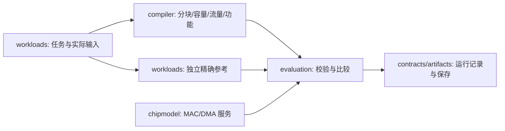

# 线性算子分块与数据驻留实验

本实验服务于[项目使命](../../PROJECT_MISSION.md)中的软硬件协同设计：在同一任务、输入和资源预算下，验证映射是否合法、功能是否正确，以及性能可能受什么资源限制。实施范围与验收见[开发计划](../../docs/development/linear_experiment_plan.md)。这是一项平台验证实验，尚未建立论文创新或真实设备性能结论。

## 运行与保存

仓库根目录、Python 3.10+、仅标准库：

```text
python -m example.linear_demo
python -m example.linear_demo --set hardware.scratch_capacity_bytes=256
python -m example.linear_demo --output .build/linear-study --source-revision YOUR_SOURCE_SNAPSHOT
python -m example.linear_demo --read .build/linear-study
```

默认使用 [linear_mapping.json](../../config/experiments/linear_mapping.json)。`--config` 可指定另一配置，`--set FIELD=JSON` 覆盖明确字段；数组整体替换。浮点任务必须同时声明 `workload.dtype` 和 `hardware.operand_dtype` 为 `float64`，并按 8 字节输入调整 scratch 容量。参数是服务能力假设，不从 INT8 的 MAC 速率推断实际设备的 FP64 速率。

输出为 JSON 比较行；成功执行与 validation_passed 分开。至少一个数值合格候选且没有已完成候选数值不合格时返回 0；容量/格式等失败记录保留，全部失败返回 1。回读使用相同判定规则。该返回码用于有限候选探索，不能证明每个候选可行；完整验收须检查每行状态与诊断。

保存目录必须全新。每个 run 子目录含 `run.json + manifest.json`，记录实际输入、有效配置、生成算法/seed、计划及身份、输出/参考、质量、指标、假设和失败原因；失败点无伪造输出。`summary.json` 是便于查看的派生产物，回读从经过完整性校验的 run bundle 重建；UUID 目录排序可能改变行顺序，比较时按 candidate 身份关联。

`source_revision` 默认 `unrecorded`，不构成完整源码归档。正式研究应记录准确 commit；有未提交改动时另保存源码快照/补丁及 Python/工具版本，再填写相应来源身份。仅保存 seed 或输入哈希不足以证明整个实验环境可复现。

## 模块边界与独立调用



这张图表示数据流。Python 依赖中 compiler 只使用 contracts，不导入 workloads/chipmodel；evaluation 负责装配。公共值是窄范围版本化线性语义，不提前替代通用 WorkloadSpec/HardwareSpec/事件协议。

独立功能调用无需配置或实验 runner：

```python
from contracts.workload.linear import LinearInputs, LinearSpec
from contracts.plan.linear import TileShape
from workloads.reference.linear import compare_output, reference_linear
from compiler.src.tiling.linear import build_plan
from compiler.src.interpret.linear import execute_plan

spec = LinearSpec(m=2, n=2, k=3)
inputs = LinearInputs(a=(1, 2, 3, 4, 5, 6), b=(7, 8, 9, 10, 11, 12))
plan = build_plan(spec, TileShape(m=1, n=1, k=2), "output_stationary")
actual = execute_plan(spec, inputs, plan, capacity_bytes=12)
assert actual == (58, 64, 139, 154)
assert compare_output(spec, actual, reference_linear(spec, inputs)).passed
```

阶段接口见 [workloads](../../workloads/UNITS.md)、[compiler](../../compiler/src/UNITS.md) 与 [runner](../experiments/runner/UNITS.md)。`evaluate_mapping(params, inputs)` 接收显式实际数据；`run_study` 为有限候选生成一次共同输入，并逐候选调用现有 `run_experiment`。没有自动搜索器、动态加载或全局模型状态。

## 语义与资源模型

- 稠密 GEMM `A[M,K] @ B[K,N]`，正整数尺寸，N=1 表达 MatVec。平坦 row-major，无转置、bias、稀疏跳零、量化 scale、FMA 或零长度维度。
- INT8 输入/INT64 输出及累加；最坏范围 `K*128*128 <= 2**63-1`。float64 采用独立精确有理数点积并最终舍入的参考，对比 K 顺序的标量浮点乘加；容差由实验声明。`1e16+1-1e16` 的反例会区分参考 1 与映射结果 0。
- 三个紧密打包且互不重叠的 scratch arena，分别容纳 A/B/C 最大有效块；A/B 每步重新载入。C 首块置零，输出驻留保留到所有 K 切片完成；回写策略每片后写回，后续切片前重读。
- 每个外部张量 ROI 的每一行独立发 DMA 请求；不把跨 stride 的子矩形误作一条连续请求。不合并跨行请求，不计地址对齐、bank/port 冲突、cache、双缓冲或异步生命周期。
- MAC 采用已有 `MacArray` 的理想独立服务。单 DMA 通道逐请求串行计服务，使用其原有 burst 与 bus rounding 规则；不额外叠加 DRAM/NoC 模型，避免重复计费。

令 W=MNK MAC，G=ceil(W/P)，理想 MAC 服务为 `(L+(G-1)II)/f_compute`。DMA 服务为 `Σ request_completion_cycles/f_dma`，逐请求启动与 burst 成本来自显式参数。资源时间下界取两者最大值，乐观允许计算与搬运重叠，忽略依赖停顿、实际 SRAM 端口与外存时延；在声明的服务模型条件下才成立。不同域 cycles 先转换成秒，不直接相加。

功能执行顺序没有驱动事件时钟，因此该值不是映射的实际完成时延，也不能用于报告真实加速比。host_elapsed_s 独立记录宿主开销；能耗缺乏校准，以 `None + unknown_reason` 表达，未实现面积或功率结论。

## 默认案例与手算证据

M=5、N=4、K=7，INT8，seed=7，64 B scratch；4 MAC lanes，1 GHz，L=II=1；DMA 500 MHz、8 B/cycle、每请求启动 1 cycle。总工作 140 MAC，按一乘一加记 280 op，唯一张量 A/B/C 分别为 35/28/160 B。

| 候选 | 分块 M/N/K | scratch 分配 | 外部 payload | DMA 服务 | 资源时间下界 | 校验 |
| --- | --- | --- | --- | --- | --- | --- |
| resident_2x2x3 | 2/2/3 | 44 B | 314 B | 174 cycles | 348 ns | 通过 |
| spill_2x2x3 | 2/2/3 | 44 B | 954 B | 294 cycles | 588 ns | 通过 |
| resident_1x2x3 | 1/2/3 | 25 B | 370 B | 230 cycles | 460 ns | 通过 |
| infeasible_full | 5/4/7 | 需要 223 B | 未执行 | 未执行 | 未知 | 容量不足 |

输出驻留第一行 A 读 `2*35=70 B`、B 读 `3*28=84 B`、C 写 `160 B`，共 314 B。三个 K 切片有两个边界，回写策略额外 `2*2*160=640 B`，共 954 B。小 M 块使 B 重读 5 次，总量 `70+140+160=370 B`。44 B scratch 来自 `2*3 + 3*2 + 2*2*8`。

驻留第一方案有 30 个 A 行请求、42 个 B 行请求、10 个最终 C 行请求：前两类共 144 DMA cycles，C 行总计 30 cycles，合计 174。回写多出 40 个 partial 行请求、120 cycles。MAC 理想服务固定 35 cycles，即 35 ns。容量改为 256 B 后整块映射可行；降低 DMA 吞吐时流量不变而下界增大。上述都是声明模型的分析结果。

## 验证与下一步

独立验证分三层：[任务与精确参考](../../tests/workloads/test_linear.py)、[编译覆盖/容量/流量](../../compiler/tests/test_linear_mapping.py)、[跨模块实验与产物](../../tests/integration/test_linear_experiment.py)。测试包括整数边界、尾块、手工合法重排、缺失/重复/越界/错序、提前释放、容量不足、浮点消减/溢出、格式能力、敏感性和保存回读。

下一轮扩展 Linear 前向/反向/参数更新及短算子链，同时选择固定版本 PyTorch 的功能交叉验证与 Timeloop/ZigZag/SCALE-Sim 的共同可比案例。先对齐语义、精度、数据流和硬件假设，再比较流量/时间。外部工具尚未接入或运行；训练执行、事件仿真、物理能耗校准分别按研究问题推进，具体路线见 [RESEARCH_ROADMAP](../../docs/RESEARCH_ROADMAP.md)。
